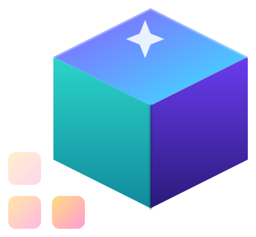

<p align="center">
  <a href="https://github.com/img2threejs">
    
  </a>
</p>

# pixi2D — img2pixi2d

> An independent OMP plugin for **reference-guided, editable PixiJS 2D scenes** — sprites, graphics, text, native 2D meshes and layered parallax, with image intake/crop/compare tools and ownership, occlusion-completion and motion-review guidance. No 3D beta dependency.

[](https://pixijs.com/)
[](https://www.python.org/)
[](https://www.npmjs.com/package/@img2threejs/pixi2d)
[](#install)

The `img2pixi2d` skill turns a single reference image into an **editable** PixiJS v8 scene inside your existing host application: every named object is a real node you can move, hide, restyle or animate independently, with provenance preserved and inferred regions labelled honestly.

---

## Table of contents

- [What you get](#what-you-get)
- [Example](#example)
- [Install](#install)
- [Recommended workflow](#recommended-workflow)
- [Copy-ready prompts](#copy-ready-prompts)
- [Manual image tools](#manual-image-tools)
- [Update, verify, troubleshoot](#update-verify-and-troubleshoot)
- [Scope and further reading](#scope-and-further-reading)
- [Project layout](#project-layout)
- [License](#license)

---

## What you get

| Capability              | What `img2pixi2d` delivers                                                                                          |
| ----------------------- | ------------------------------------------------------------------------------------------------------------------ |
| Editable scene          | A `create<Subject>()` factory whose objects are real `Container`/`Graphics`/`Text`/`Sprite`/`Mesh2D` instances.   |
| Ownership              | One root per scene; each named node has a label and is returned for independent control.                          |
| Image intake            | Original saved byte-for-byte plus an immutable sRGB RGBA working PNG.                                              |
| Crop & compare          | Alpha-preserving crops and side-by-side renders of the actual host canvas.                                          |
| Motion                  | Bounded per-object motion driven by your existing ticker — no second render loop.                                  |
| Occlusion handling      | Supplied/reviewed mattes; inferred hidden-region completion requires explicit authorization.                       |
| Honest labels           | Inferred mattes and completed pixels are labelled; a flat image never claims exact hidden artwork.                 |

**Not in scope:** automatic segmentation, automatic inpainting, 3D reconstruction, redistribution of user artwork. For real Mesh3D/Sprite3D/Model3D, see [`pixi3d`](https://github.com/img2threejs/pixi3d).

---

## Example

The shipped [`examples/showcase.ts`](examples/showcase.ts) is an authored `Graphics` + `Text` scene at **960 × 640**, **not** a reconstruction of a user image or evidence of image-to-scene fidelity. The balloon and clouds move independently; the factory adds no Application or ticker of its own.

To reproduce it inside your existing host, copy the file to `src/plugin-showcase.ts` in the host project and, after the host's Application is initialized:

```ts
import { createShowcase } from './plugin-showcase';

const showcase = createShowcase(app.stage); // Design size: 960 x 640.
showcase.setTime(1.5);                       // Seconds; only example-owned objects move.
showcase.reset();
// On unmount: remove any host-owned ticker callback first, then:
// showcase.dispose();
```

For animated playback, let your **existing** ticker pass elapsed seconds into `setTime`; do not start a second render loop. This example uses vector primitives; it does not demonstrate source-image segmentation or native mesh deformation.

---

## Install

**Requirements**

- OMP and Git on `PATH`
- An existing PixiJS **v8** host project (verified release: **PixiJS 8.22.0**)
- **Python 3.10+** with `venv` / pip for the image tools (not needed to run an integrated scene)
- **Node.js 18+** for the npm installer
- Standalone **Bun** on `PATH` for native OMP removal

The GitHub repository is **public**; cloning does not require a GitHub account. Root `package.json` stays `private: true` to prevent publishing the entire source tree to npm. The separately published [`@img2threejs/pixi2d`](https://www.npmjs.com/package/@img2threejs/pixi2d) package contains only the installer.

### Recommended: pinned npm installer

On **macOS / Linux**:

```sh
npx --yes @img2threejs/pixi2d@latest install --dry-run
npx --yes @img2threejs/pixi2d@latest install --yes
npx --yes @img2threejs/pixi2d@latest doctor
PLUGIN="$HOME/.local/share/img2threejs/pixi2d"
```

The first `--yes` allows npx to download the CLI; the final `--yes` authorizes installer mutations. The installer clones a reviewed, pinned commit, prepares `.venv` with Pillow, and runs `omp plugin link`. It refuses dirty/unrelated checkouts and registrations pointing elsewhere. See [installer commands](cli/README.md).

This is a **native OMP plugin**, not an img2 harness plugin; `img2 add pixi2d` is unsupported. Start a **new OMP session** after installation, then invoke `/skill:img2pixi2d` inside your existing PixiJS project.

### Alternative: manual Git installation

```sh
mkdir -p "$HOME/.local/share/img2threejs"
git clone https://github.com/img2threejs/pixi2d.git \
  "$HOME/.local/share/img2threejs/pixi2d"

PLUGIN="$HOME/.local/share/img2threejs/pixi2d"
python3 -m venv "$PLUGIN/.venv"
"$PLUGIN/.venv/bin/python" -m pip install \
  -r "$PLUGIN/skills/img2pixi2d/requirements.txt"
omp plugin link "$PLUGIN"
omp plugin list --json
```

Already cloned elsewhere? Set `PLUGIN` to that absolute path and run `omp plugin link "$PLUGIN"`. Keep the clone in place — OMP links it by symlink. **Do not** run `npm install` inside the source plugin; Pixi dependencies belong to the host.

---

## Recommended workflow

1. **Start OMP inside the existing host project**, attach the original image, and invoke `/skill:img2pixi2d`.
2. **Name the editable objects**, required controls, target viewport and motion limits. Supply original layers / mattes / fonts when available.
3. **Review the ownership and occlusion plan** before any animation. Preserve source pixels; authorize inferred hidden-region completion explicitly, or limit motion to supported poses.
4. **Approve in stages** — layout, then appearance, then motion. Reuse one admitted reference and the host preview; diagnose specific failures instead of restarting the scene.
5. **Require real evidence** — actual canvas captures, critical-region comparisons, independent hide/move tests, motion extrema, reset, and resource-safe teardown. Pixel similarity alone does not establish editability or animation quality.

For best results, give a bounded task and concrete defects. Use 2D meshes for continuous deformation and layered parallax for depth cues; neither requires the 3D plugin. The skill is an **agent workflow**, not an automatic generator launched by installation.

---

## Copy-ready prompts

Replace the bracketed inputs with real paths and requirements. Attach the referenced image; never leave placeholders unresolved.

### Reconstruct an editable scene

```text
/skill:img2pixi2d
Use [reference image path] in this existing PixiJS project. Match its silhouette,
colors, text and layout at [viewport dimensions]. Make [object names] independently
editable. Required controls: [controls]. Allowed motion: [limits].
Preserve the original reference and unrelated code. Plan ownership, mattes,
occlusion and pivots before building. Do not invent hidden pixels; request my
approval if completion is needed. Use the existing Application and preview.
Deliver a subject-specific factory, reconstruction data and actual canvas evidence.
Verify critical details, hide/move isolation, full motion, reset and disposal.
```

### Improve an existing reconstruction without regenerating it

```text
/skill:img2pixi2d
Continue the existing scene against [same admitted reference path]. The defect is
[object/region and observed failure]. Preserve the accepted layout and other objects.
Fix only the diagnosed cause. Requested motion is [range]; completion permission
is [none or explicitly authorized regions]. Compare actual before/after captures,
exercise the affected object independently, and verify neutral-pose reset.
```

---

## Manual image tools

Use the same plugin Python environment. Run from the skill directory; replace the host/image paths with your own:

```sh
PROJECT="/absolute/path/to/your-pixi-project"
IMAGE="/absolute/path/to/reference.png"

cd "$PLUGIN/skills/img2pixi2d"
"$PLUGIN/.venv/bin/python" -m forge.cli --help
"$PLUGIN/.venv/bin/python" -m forge.cli intake "$IMAGE" --workspace "$PROJECT/.img2pixi2d"

# Example only — choose X Y WIDTH HEIGHT inside a visible region of your image.
"$PLUGIN/.venv/bin/python" -m forge.cli crop \
  --workspace "$PROJECT/.img2pixi2d" \
  --bbox 0 0 16 16 --out layers/observed-region.png
```

`intake` preserves the original bytes plus an immutable sRGB RGBA working PNG. A crop must contain visible pixels; replace the example bbox for your image. Add `--mask masks/part.png` for a supplied/reviewed matte, relative to the workspace. **`crop` does not segment or inpaint.** Restore trimmed placement using the crop metadata's `trimOffset`.

Capture the **actual host canvas** to the path below, at the working image's artboard dimensions, before comparing:

```sh
"$PLUGIN/.venv/bin/python" -m forge.cli compare \
  --reference "$PROJECT/.img2pixi2d/reference/working.png" \
  --render    "$PROJECT/.img2pixi2d/evidence/render.png" \
  --out       "$PROJECT/.img2pixi2d/evidence"
```

Do not resize images to manufacture agreement. RGB / alpha / SSIM metrics are diagnostics; inspect critical crops and motion with vision. HTTPS reference admission requires explicit consent and `intake --allow-network`.

---

## Update, verify and troubleshoot

For an installer-managed checkout:

```sh
npx --yes @img2threejs/pixi2d@latest update --yes
npx --yes @img2threejs/pixi2d@latest doctor
npx --yes @img2threejs/pixi2d@latest remove --yes
```

Installer updates use that CLI version's reviewed pin, not the latest Git branch. Removal unregisters the plugin but keeps its source checkout, Python environment and host artwork.

For a manually managed branch checkout:

```sh
git -C "$PLUGIN" pull --ff-only
cd "$PLUGIN/skills/img2pixi2d"
"$PLUGIN/.venv/bin/python" tests/test_tools.py --image "$IMAGE" -v
```

- Reinstall requirements when they change; start a new OMP session after updates.
- **Clone failed** — check the public Git URL, network/proxy settings and target directory; no organization access grant is required. Never put credentials in clone URLs.
- **Skill missing** — check `omp plugin list --json`, the linked clone and the new session.
- **Empty crop** — choose a visible region and the correct matte; alpha-preserving crop is not segmentation.
- `omp plugin uninstall pixi2d` removes registration, not host artwork.

---

## Scope and further reading

- Skill workflow — [`skills/img2pixi2d/SKILL.md`](skills/img2pixi2d/SKILL.md)
- Reconstruction — [`skills/img2pixi2d/references/reconstruction.md`](skills/img2pixi2d/references/reconstruction.md)
- PixiJS integration — [`skills/img2pixi2d/references/pixijs.md`](skills/img2pixi2d/references/pixijs.md)
- Object separation — [`skills/img2pixi2d/references/object-separation.md`](skills/img2pixi2d/references/object-separation.md)
- Occlusion completion — [`skills/img2pixi2d/references/occlusion-completion.md`](skills/img2pixi2d/references/occlusion-completion.md)
- Review — [`skills/img2pixi2d/references/review.md`](skills/img2pixi2d/references/review.md)

The **host** owns the Application, renderer, ticker and shared resources; factories own only their nodes and listeners. A flattened image cannot reveal exact hidden artwork — label inferred mattes and completion honestly. Real Mesh3D/Sprite3D/Model3D belongs to [`pixi3d`](https://github.com/img2threejs/pixi3d).

Do not upload user artwork, host workspaces, credentials, apps or dependency builds. The included example is authored code, not redistributed reference artwork. Repository access does not grant artwork redistribution rights.

---

## Project layout

```text
pixi2d/
├── README.md
├── package.json
├── assets/                  # img2 brand logo and its license
├── cli/                     # Published installer-only npm package
├── examples/
│   └── showcase.ts          # Authored 960×640 Graphics + Text factory
└── skills/
    └── img2pixi2d/          # OMP skill bundle (workflow + Python tools)
        ├── SKILL.md
        ├── requirements.txt
        ├── forge/           # `forge.cli` (intake / crop / compare)
        └── references/      # reconstruction, pixijs, object-separation,
                             # occlusion-completion, review
```

---

## License

- **Skill, Python tools and example:** no repository-wide source-code license is declared. Public GitHub visibility and npm's `private: true` flag are not code licenses; contact the maintainers before reuse or redistribution beyond granted permissions.
- **npm installer:** Apache-2.0, scoped to `cli/`; see [`cli/LICENSE`](cli/LICENSE).
- **img2 logo:** reused from the img2threejs brand asset under Apache-2.0; see [`assets/LICENSE`](assets/LICENSE).
- **User artwork, fonts and reference images:** retain their own ownership and licensing. Repository access does not grant redistribution rights.